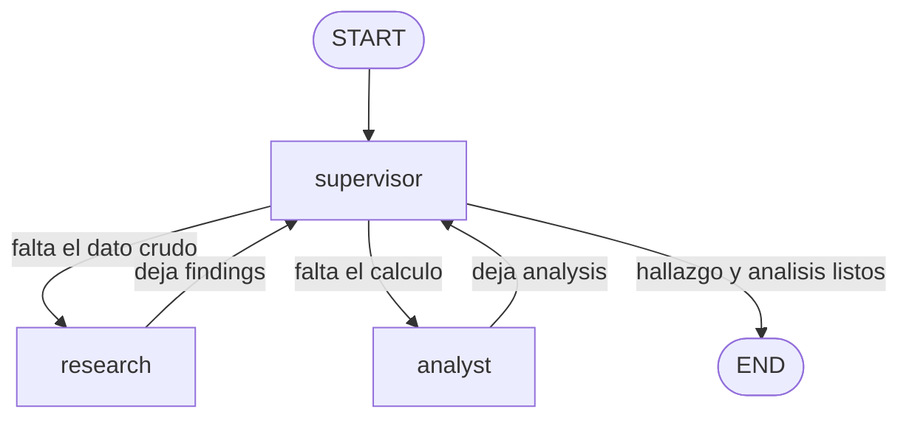

# Orquestador de investigación y análisis

Un supervisor decide quién habla. El investigador solo busca. El analista solo calcula. Ninguno de los dos elige al otro: si el dato está incompleto, el supervisor manda a refinar y, a los 6 pasos, corta.

## Topología

Jerárquica. El supervisor es el único router. Los especialistas vuelven siempre a él, no se llaman entre sí. Así no se pisan: el conflicto (dato vacío, análisis sin números, id inexistente) lo resuelve el supervisor con una rúbrica, y `apply_stop` impide que declare `finish` si falta una de las dos piezas o que el ciclo pase de 6 pasos.



## Estado

`state.py` hereda de `MessagesState`. Además guarda `findings`, `analysis`, `next_agent`, `steps` y `task_completed`. El investigador no recibe el análisis. El analista recibe la pregunta y el hallazgo, no el historial del supervisor.

## Cómo levantarlo

Python 3.12.

```bash
python3.12 -m venv .venv
source .venv/bin/activate
pip install -r requirements.txt
cp .env.example .env
```

Completá `OPENAI_API_KEY` en `.env`.

```bash
python main.py
```

La consulta de prueba obliga a las dos especialidades: buscar los pedidos del cliente 102 y calcular si el ticket promedio supera 4000. `python main.py` reescribe `traces/delegacion.json`. El archivo que está en el repo es el ejemplo de esa delegación.

`demo.ipynb` muestra el mismo flujo: el grafo, las herramientas y la traza.
